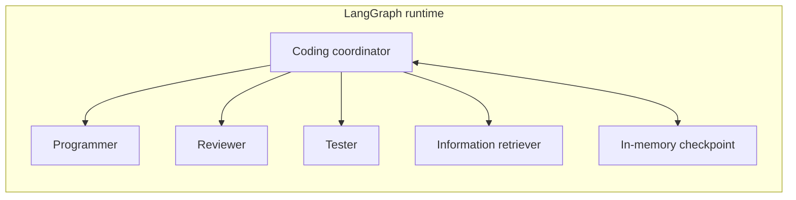
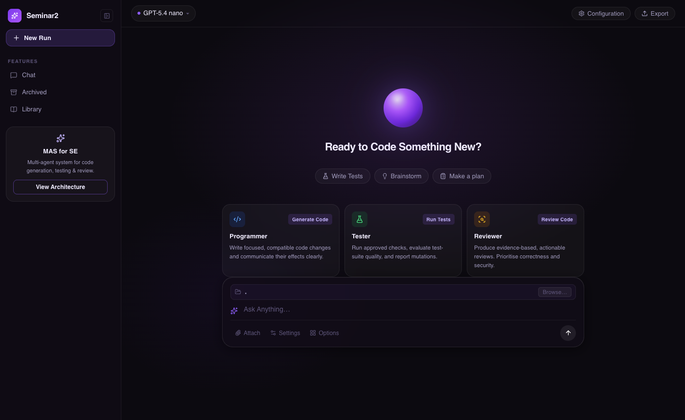

# Coding Agent

A local, human-in-the-loop coding system built with FastAPI, LangGraph, Deep
Agents, and Azure OpenAI. Give it a task and an absolute source-directory path;
the coordinator delegates work to specialized agents, streams progress to a web
or terminal client, and pauses before any file mutation or shell command.

## Overview

The application has three ways to interact with the same agent runtime:

- A React web UI for starting tasks, following agent activity, and reviewing
  approval requests.
- A Rich terminal client with live output and interactive approvals.
- A REST and Server-Sent Events (SSE) API for custom integrations.

Each run receives its own LangGraph graph and in-memory checkpoint. The API
serializes work so only one unfinished run can exist at a time, including while
a run is waiting for approval. The selected `source_folder` becomes the root for
project file tools and the working directory for approved commands, alongside a
protected, read-only skills mount.

## Features

- Coordinator-led multi-agent workflow with four specialists:
  - **Programmer** — implements approved file changes.
  - **Reviewer** — performs independent, read-only code review.
  - **Tester** — runs checks through approval-gated shell access.
  - **Information retriever** — inspects the workspace and searches the web
    through Tavily.
- Human approval for file writes, edits, deletions, and shell commands.
- Live SSE events for status, assistant text, agent activity, approval requests,
  completion, and failure.
- Replayable event history with reconnect support.
- Web, terminal, polling, and streaming interfaces over one backend.
- Per-run workspace selection with absolute-path validation and symlink
  resolution.
- Optional LangSmith and Langfuse observability.
- Dependency injection and deterministic test doubles for offline tests.

## Agent Architecture



## Quick start

### Prerequisites

- Python 3.12 or newer
- [uv](https://docs.astral.sh/uv/)
- An Azure OpenAI deployment
- A Tavily API key
- Node.js 18 or newer for the web UI

#### Backend setup

```bash
uv sync --all-groups
cp .env.example .env
```

Add your Azure OpenAI and Tavily credentials to `.env`, then start the API:

```bash
uv run uvicorn src.main:app --host 127.0.0.1 --port 8000 --workers 1
```

You can also run `uv run python -m src.main`. Check readiness at
[http://127.0.0.1:8000/health](http://127.0.0.1:8000/health) and browse the generated API documentation at
[http://127.0.0.1:8000/docs](http://127.0.0.1:8000/docs).

#### UI Setup

The React interface provides a task composer, source-folder picker, streamed
agent activity, conversation history for the current browser session, run-status
indicators, and an approval panel for proposed tool actions.



With the backend running, start the UI in a second terminal:

```bash
cd ui
npm install
cp .env.example .env
npm run dev
```

Open [http://localhost:5173](http://localhost:5173). In development, an empty `VITE_API_URL` uses the
Vite proxy; set it to `http://127.0.0.1:8000` to call the backend directly.
Production assets are created with `npm run build` in `ui/dist/`.

See the [UI guide](ui/README.md) for its configuration, shortcuts, components,
and backend endpoints.

### Backend Usage

#### Terminal client

Start the backend separately, then connect from another shell:

```bash
uv run python -m src.terminal \
  --task "Review this project for bugs" \
  --source-folder /absolute/path/to/project
```

Both arguments are optional and are prompted for when omitted. The API URL is
selected in this order:

1. `--api-url`
2. `CODING_AGENT_API_URL` from the terminal process environment
3. `http://127.0.0.1:8000`

The terminal does not load `CODING_AGENT_API_URL` from `.env`; export it in the
shell or pass `--api-url`. It also does not upload local files. The source path
must already be accessible on the API server.

#### API usage

Submit a run:

```bash
curl -X POST http://127.0.0.1:8000/v1/runs \
  -H 'Content-Type: application/json' \
  -d '{
    "task": "Review this project for bugs.",
    "source_folder": "/absolute/path/to/project"
  }'
```

The API returns HTTP 202 with a generated `run_id`. Use it to poll the run or
stream events:

```bash
curl http://127.0.0.1:8000/v1/runs/RUN_ID
curl -N http://127.0.0.1:8000/v1/runs/RUN_ID/events
```

Run states are `queued`, `running`, `awaiting_approval`, `completed`, and
`failed`. SSE event types are:

| Event                 | Purpose                                                |
| --------------------- | ------------------------------------------------------ |
| `status`            | Reports queued and running transitions.                |
| `text_delta`        | Streams visible text with agent and subgraph metadata. |
| `agent_activity`    | Reports graph-node activity.                           |
| `approval_required` | Supplies ordered actions awaiting decisions.           |
| `completed`         | Returns the coordinator's final output.                |
| `failed`            | Returns a sanitized error.                             |

Reconnect with the last received event ID:

```bash
curl -N -H 'Last-Event-ID: 12' \
  http://127.0.0.1:8000/v1/runs/RUN_ID/events
```

The latest 1,000 events per run are retained in memory. The server sends a
heartbeat every 15 seconds while idle. If replay history has expired, poll the
run endpoint until it reaches a terminal state.

#### Approvals

When a run reaches `awaiting_approval`, inspect every item in `approvals` and
send exactly one decision for each ordered action:

```bash
curl -X POST http://127.0.0.1:8000/v1/runs/RUN_ID/resume \
  -H 'Content-Type: application/json' \
  -d '{
    "decisions": {
      "INTERRUPT_ID": [
        {"type": "approve"}
      ]
    }
  }'
```

Supported decision shapes are:

```json
{"type":"approve"}
{"type":"reject","message":"Do not run this command."}
{"type":"edit","edited_action":{"name":"execute","args":{"command":"pytest -q"}}}
```

Edits must keep the original tool name and satisfy its argument schema. A
rejection gives feedback to the agent but does not cancel the run. Decision
order must match the returned action order; invalid, missing, or stale decisions
are rejected without consuming the pending approval.

### Configuration

Server environment variables override values in `.env`.

| Variable                          | Default / requirement                                                        |
| --------------------------------- | ---------------------------------------------------------------------------- |
| `AZURE_OPENAI_API_KEY`          | Required Azure OpenAI credential.                                            |
| `AZURE_OPENAI_ENDPOINT`         | Required Azure OpenAI endpoint.                                              |
| `OPENAI_API_VERSION`            | `2025-04-01-preview` in `.env.example`.                                  |
| `TAVILY_API_KEY`                | Required for the information-retrieval agent.                                |
| `CODING_MODEL`                  | `azure_openai:gpt-5.4-nano` in `.env.example`.                           |
| `CODING_WORKSPACE_ROOT`         | `.`; default for direct Python usage. API runs use their submitted folder. |
| `CODING_MAX_REMEDIATION_CYCLES` | `2`.                                                                       |
| `CODING_SHELL_TIMEOUT_SECONDS`  | `120`.                                                                     |
| `CODING_AGENT_API_URL`          | Terminal-only API selection; defaults to`http://127.0.0.1:8000`.           |
| `LOG_LEVEL`                     | `debug`.                                                                   |
| `LOG_JSON`                      | `false`.                                                                   |
| `LOG_DIR`                       | `logs`.                                                                    |

Deployment availability depends on the configured Azure OpenAI account. API
clients can choose a source folder but cannot override model credentials.

#### Observability

LangSmith tracing is configured with the standard environment variables in
`.env.example`:

```dotenv
LANGSMITH_TRACING=true
LANGSMITH_ENDPOINT=
LANGSMITH_API_KEY=
LANGSMITH_PROJECT=
```

Langfuse is optional and independent of LangSmith:

```dotenv
LANGFUSE_TRACING_ENABLED=true
LANGFUSE_PUBLIC_KEY=pk-lf-your-public-key
LANGFUSE_SECRET_KEY=sk-lf-your-secret-key
LANGFUSE_BASE_URL=https://cloud.langfuse.com
```

Restart the backend after changing tracing settings. Every initial execution and
approval resume receives a fresh callback, while all traces for a run share its
`run_id` as the Langfuse session ID.

Tracing can capture prompts, source code, tool input, command output, and model
responses. Enable it only when sending workspace data to the configured service
is acceptable; the application applies no custom redaction.

## Project structure

```text
.
├── src/
│   ├── agents/       # Coordinator and specialist factories
│   ├── models/       # LLM setup and API data contracts
│   ├── prompts/      # Coordinator and specialist instructions
│   ├── routes/       # Run, streaming, health, and UI-helper endpoints
│   ├── services/     # Run lifecycle, event streaming, and tracing
│   ├── skills/       # Skills mounted read-only into agent workspaces
│   ├── terminal/     # Rich terminal client
│   ├── tools/        # Approval metadata and Tavily search
│   ├── main.py       # FastAPI application factory and entry point
│   └── settings.py   # Environment-backed configuration
├── tests/            # Backend unit and integration tests
├── ui/               # React, TypeScript, and Vite web client
├── .env.example      # Backend configuration template
└── pyproject.toml    # Python dependencies and tool configuration
```

## Benchmark

Evaluate the coding agent locally against SWE-bench Verified`benchmarks/swebench`. The workflow generates official-format
predictions and grades them with the SWE-bench Docker harness.

Benchmark mode automatically approves agent writes and shell commands, so it
must run inside a disposable container or virtual machine. See the
[benchmark guide](benchmarks/README.md) for setup, safety requirements, example
commands, generated artifacts, and grading instructions.

## Limitations and future work

### Current limitations

- The server has no authentication and must not be exposed as a shared public
  service.
- Only one unfinished run is allowed across the process.
- Runs, graph checkpoints, event history, and UI conversation history are kept
  in memory and disappear after a restart or browser refresh.
- Source folders must already exist on the API host; there is no upload or
  remote-repository checkout workflow.
- File tools are rooted to the selected workspace, but approved shell commands
  execute on the host and are not sandboxed.
- The remediation-cycle limit is prompt-directed rather than a strict execution
  counter. A graph recursion limit provides a final runaway safeguard.
- Failures do not roll back file changes or commands that were already approved
  and executed.
- Event replay is limited to the latest 1,000 events for each run.

### Possible future work

- Add authentication, authorization, and per-user workspace isolation.
- Persist runs, checkpoints, approvals, and event history in durable storage.
- Support multiple concurrent runs with an explicit workspace-locking strategy.
- Execute commands in containers or another hardened sandbox.
- Add repository cloning or controlled workspace-upload workflows.
- Persist UI conversations and add reliable run cancellation.
- Add production deployment guidance, metrics, and retention controls for traces
  and logs.
